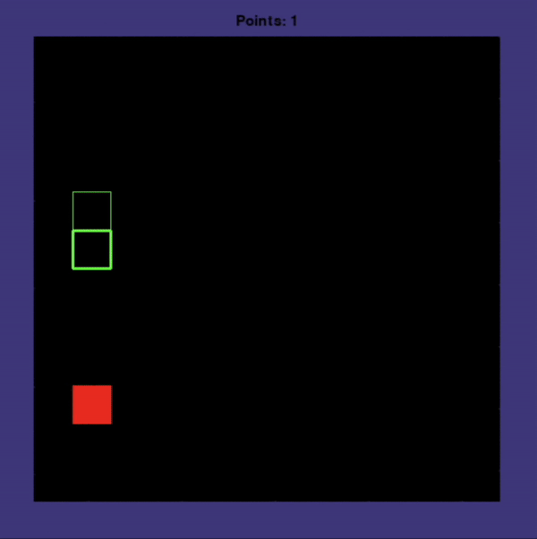
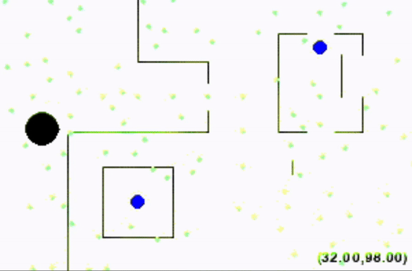

# Artificial intelligence and machine learning projects

**Eleven projects from UIUC's AI and applied-ML courses, spanning classical ML, search and planning, probabilistic models, deep learning, and reinforcement learning.**


Coursework from UIUC CS440 (Artificial Intelligence) and CS441 (Applied Machine Learning). Each project is a self-contained implementation of a core method, built up from starter code, with the algorithm written by hand rather than pulled from a library where the point was to understand it.

## Highlights

### Reinforcement learning: self-playing Snake


A tabular Q-learning agent that teaches itself to play Snake. The board is framed as a Markov decision process over a discretised state (food direction, nearby walls, and body), and the agent learns a policy through an exploration function and an adaptive learning rate. It reaches around 14 points per game after training.

### Hidden Markov Model part-of-speech tagger


A Viterbi decoder that tags words with their part of speech. It learns initial, transition, and emission probabilities from tagged text, adds Laplace smoothing and special handling for rare (hapax) words, and lifts accuracy from a 70% majority-tag baseline to about 76% on unseen words.

## All projects

| Project | Method | Notes |
|---|---|---|
| KNN and K-means | k-nearest neighbours, k-means (FAISS-accelerated) | classification on MNIST, regression on temperature data |
| Bigram Naive Bayes | Naive Bayes with Laplace smoothing + bigram mixture | movie-review sentiment, ~96% accuracy |
| PCA and SVM | PCA, logistic regression, linear SVM | 87 components capture ~90% variance on MNIST |
| PDF and Gaussian | Gaussian mixture models, EM | image colour segmentation, outlier detection |
| Maze search | A* / best-first search | EightPuzzle and WordLadder with a Manhattan heuristic |
| Trees and MLPs | decision tree, random forest, gradient boosting, MLP | temperature regression and penguin-species classification |
| Deep learning | transfer learning with ResNet-34 (PyTorch) | fine-tuned on the Oxford-IIIT Pet dataset |
| Configuration-space planning | A* over a discretised joint space | an articulated robot navigating a maze |
| HMM POS tagger | Viterbi decoding | ~76% on unseen words (see highlights) |
| CNN image classifier | convolutional neural net (PyTorch) | ~80% accuracy on unseen RGB images |
| Reinforcement learning Snake | tabular Q-learning | ~14 points per game (see highlights) |

## Tech stack

Python · PyTorch, scikit-learn, NumPy, SciPy, pandas · OpenCV · FAISS · pygame · NLTK-style text processing

## Repository structure

```
AI_projects/
├── docs/
│   ├── RL.gif, HMM-POS.gif     # demo outputs
│   └── MP*/                     # assignment briefs + reports
└── src/
    └── MP*/                     # one folder per project (code + data)
```

## Notes

Coursework, shared as a portfolio reference. Please don't submit any of it as your own.
